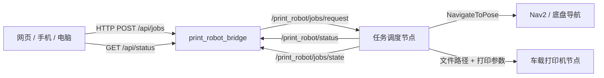

# RDK X5 ROS2 运行与底盘配合指南

> 公开归档说明：本文是部署与待集成步骤，不是整机验收记录。仓库包含 Web/PWA、演示 HTTP 服务、ROS2 HTTP 桥接和 USB 打印节点；调度器、Nav2/底盘驱动、真实地图与设备均需另行提供。桥接 API 可达只表示服务连接，CUPS 命令成功只表示打印请求已提交，均不证明导航就绪或纸张已输出。所有工位/地图坐标与用户数据为示例，不能直接用于实机。当前验证见 [验证记录](../docs/VALIDATION.md)。

目标：在已有 ROS2 环境的 RDK X5 上运行打印机器人程序，并让它和底盘/Nav2 配合。

这篇不讲刷系统，也不讲 ROS2 安装。默认你已经具备：

```text
RDK X5 可以正常开机
ROS2 已经可以运行
底盘驱动已经能控制小车运动
Nav2 或你们自己的导航程序已经能让小车去指定坐标
```

## 1. 新硬件结构

项目已经调整为：

```text
打印机直接安装在小车上，作为车载外设。
```

因此旧流程：

```text
去打印区 → 取打印好的文件 → 配送到工位
```

已经不再适用。

新流程是：

```text
网页提交打印任务
        ↓
RDK X5 接收文件和参数
        ↓
小车直接前往目标工位
        ↓
车载打印机按任务模式打印
```

支持两种打印模式：

```text
mobile_print       边走边打印：小车前往目标工位，同时控制车载打印机打印
manual_at_station  到达后人工：小车先到目标工位，由现场人员操作车载打印机打印
```

## 2. 程序各部分负责什么

```text
网页
  用户上传文件、选择目标工位、选择打印模式

print_robot_bridge
  RDK X5 上运行的桥接节点
  接收网页 HTTP 请求
  保存上传文件
  发布 ROS2 任务 topic

调度节点
  你们需要实现
  订阅打印任务
  控制底盘导航
  控制车载打印机
  向网页反馈进度

底盘/Nav2
  接收导航目标
  控制小车前往目标工位

车载打印机节点
  接收文件路径和打印参数
  调用 CUPS、IPP、串口、USB 或厂商 SDK 打印
```

## 3. ROS2 节点关系



重点：

```text
print_robot_bridge 不直接控制底盘。
真正决定“先打印还是先走”的，是你们的调度节点。
```

## 4. 编译并启动桥接节点

项目放在 RDK X5 上后，目录建议是：

```text
/opt/office-print-robot-console/ros2_ws/src/print_robot_bridge/
```

编译：

```bash
cd /opt/office-print-robot-console/ros2_ws
source /opt/ros/humble/setup.bash
colcon build --symlink-install
source install/setup.bash
```

启动：

```bash
ros2 launch print_robot_bridge bridge.launch.py host:=0.0.0.0 port:=8080
```

看到：

```text
HTTP API listening on http://0.0.0.0:8080
```

说明桥接节点已经运行。

网页连接设置中填写：

```text
HTTP API：http://<RDK_X5_IP>:8080
```

## 5. 测试网页任务是否进入 ROS2

打开一个终端：

```bash
source /opt/ros/humble/setup.bash
source /opt/office-print-robot-console/ros2_ws/install/setup.bash
ros2 topic echo /print_robot/jobs/request
```

然后在网页提交一个任务。

你应该看到类似：

```json
{
  "id": "JOB-123456",
  "fileName": "demo.pdf",
  "filePath": "/tmp/print_robot_uploads/JOB-123456/demo.pdf",
  "targetStation": "C-05",
  "targetLabel": "产品 C-05",
  "targetPose": {
    "x": 4.1,
    "y": 0.1,
    "yaw": 1.57
  },
  "printSettings": {
    "copies": 1,
    "pages": "全部",
    "colorMode": "mono",
    "duplex": "duplex",
    "paperSize": "A4",
    "priority": "normal",
    "printMode": "mobile_print"
  }
}
```

如果能看到这段 JSON，说明：

```text
网页 → RDK X5 HTTP API → ROS2 topic
```

已经打通。

## 6. 关键 topic

### /print_robot/jobs/request

类型：

```text
std_msgs/msg/String
```

方向：

```text
print_robot_bridge 发布
调度节点订阅
```

用途：新打印任务。

### /print_robot/jobs/cancel

方向：

```text
print_robot_bridge 发布
调度节点订阅
```

用途：网页取消任务。

### /print_robot/status

方向：

```text
调度节点发布
print_robot_bridge 订阅
网页读取
```

用途：机器人位置、电量、车载打印机状态、等待时间。

### /print_robot/jobs/state

方向：

```text
调度节点发布
print_robot_bridge 订阅
网页读取
```

用途：任务进度，例如 `printing_en_route`、`awaiting_manual_print`、`done`。

## 7. 任务状态建议

推荐状态：

```text
queued                 排队中
printing_en_route      边走边打印
navigating_to_target   前往工位
awaiting_manual_print  到达后等待人工打印
delivering             到达/交付中
done                   已完成
canceled               已取消
error                  异常
```

两种模式的建议流程：

```text
mobile_print:
queued → printing_en_route → delivering → done

manual_at_station:
queued → navigating_to_target → awaiting_manual_print → done
```

## 8. 调度节点应该怎么处理任务

调度节点收到 `/print_robot/jobs/request` 后：

```text
1. 解析 JSON
2. 读取 filePath
3. 读取 printSettings
4. 读取 printSettings.printMode
5. 读取 targetPose
6. 根据 printMode 决定流程
```

### mobile_print 模式

```text
1. 发布任务状态 printing_en_route
2. 向车载打印机节点下发打印指令
3. 同时向 Nav2 下发 targetPose
4. 到达目标工位后确认打印是否完成
5. 发布 done
```

适合：

```text
打印时间较长
路程较长
希望节省整体等待时间
```

### manual_at_station 模式

```text
1. 发布任务状态 navigating_to_target
2. 向 Nav2 下发 targetPose
3. 小车到达目标工位
4. 发布 awaiting_manual_print
5. 现场人员操作车载打印机
6. 人工核对打印件与交付结果后发布 done（超时应进入异常流程）
```

适合：

```text
打印机需要人工确认
打印件需要现场检查
暂时还没有打通自动打印接口
```

## 9. 如何把 targetPose 发给底盘/Nav2

网页任务中的目标点是：

```json
"targetPose": {
  "x": 4.1,
  "y": 0.1,
  "yaw": 1.57
}
```

如果你使用 Nav2，需要把它转换成 `NavigateToPose` action。

Yaw 转四元数：

```python
import math

def yaw_to_quaternion(yaw):
    return {
        "x": 0.0,
        "y": 0.0,
        "z": math.sin(yaw / 2.0),
        "w": math.cos(yaw / 2.0),
    }
```

发送给 Nav2 的 frame 通常是：

```text
map
```

## 10. 先单独测试底盘

在接打印任务前，先确认底盘能去目标点。

查看 action：

```bash
ros2 action list
```

如果使用 Nav2，应看到：

```text
/navigate_to_pose
```

手动发一个测试目标：

```bash
ros2 action send_goal /navigate_to_pose nav2_msgs/action/NavigateToPose "{
  pose: {
    header: {frame_id: 'map'},
    pose: {
      position: {x: 1.0, y: 0.0, z: 0.0},
      orientation: {w: 1.0}
    }
  }
}"
```

如果小车不会动，先排查底盘和 Nav2，不要先怀疑网页。

## 11. USB 车载打印机节点怎么接

现在 ROS2 包里已经添加了：

```text
usb_printer_node
```

它会调用 RDK X5 系统里的 CUPS/`lp` 命令控制 USB 打印机。

### 11.1 先确认系统能识别 USB 打印机

把打印机 USB 线接到 RDK X5，然后查看：

```bash
lsusb
```

如果能看到打印机厂商或型号，说明 USB 设备识别到了。

再查看 CUPS 是否能看到打印机：

```bash
lpstat -p
lpstat -d
```

如果还没有打印机，需要先在 RDK X5 系统里把 USB 打印机添加到 CUPS。添加成功后，再用命令测试：

```bash
lp /tmp/print_robot_uploads/JOB-123456/demo.pdf
```

这条命令能打印，`usb_printer_node` 才能稳定工作。

### 11.2 启动 USB 打印节点

单独启动：

```bash
ros2 launch print_robot_bridge usb_printer.launch.py printer_name:=你的打印机名称
```

如果你已经设置了默认打印机，也可以不填 `printer_name`：

```bash
ros2 launch print_robot_bridge usb_printer.launch.py
```

同时启动网页桥接和 USB 打印节点：

```bash
ros2 launch print_robot_bridge robot_print_system.launch.py \
  host:=0.0.0.0 \
  port:=8080 \
  printer_name:=你的打印机名称
```

### 11.3 mobile_print 自动打印

网页任务如果是：

```json
{
  "printSettings": {
    "printMode": "mobile_print"
  }
}
```

`usb_printer_node` 会自动订阅 `/print_robot/jobs/request` 并开始打印。

### 11.4 manual_at_station 到达后打印

网页任务如果是：

```json
{
  "printSettings": {
    "printMode": "manual_at_station"
  }
}
```

`usb_printer_node` 不会立刻打印。调度节点应该先让小车到目标工位，然后发布：

```bash
ros2 topic pub /print_robot/printer/request std_msgs/msg/String "{data: '{\"id\":\"JOB-123456\",\"filePath\":\"/tmp/print_robot_uploads/JOB-123456/demo.pdf\",\"force\":true,\"printSettings\":{\"copies\":1,\"pages\":\"全部\",\"colorMode\":\"mono\",\"duplex\":\"single\",\"paperSize\":\"A4\"}}'}"
```

这样才会触发现场打印。

### 11.5 打印节点使用的字段

打印节点会读取：

```json
{
  "id": "JOB-123456",
  "filePath": "/tmp/print_robot_uploads/JOB-123456/demo.pdf",
  "printSettings": {
    "copies": 1,
    "pages": "全部",
    "colorMode": "mono",
    "duplex": "duplex",
    "paperSize": "A4"
  }
}
```

打印节点会发布：

```text
/print_robot/printer/state
/print_robot/jobs/state
```

注意：默认 `backend=cups`。`backend=raw` 只适合打印机本身能直接理解文件内容的情况，大多数办公打印机建议用 CUPS。

## 12. 调度节点伪代码

```python
收到 /print_robot/jobs/request:
    job = json.loads(msg.data)
    mode = job["printSettings"].get("printMode", "mobile_print")

    if mode == "mobile_print":
        发布任务状态(job.id, "printing_en_route", 20)
        usb_printer_node 会自动开始打印
        导航到 job["targetPose"]
        等待导航完成
        等待打印后端完成请求，并另外确认实际出纸
        发布任务状态(job.id, "done", 100)

    if mode == "manual_at_station":
        发布任务状态(job.id, "navigating_to_target", 20)
        导航到 job["targetPose"]
        等待导航完成
        发布任务状态(job.id, "awaiting_manual_print", 85)
        发布 /print_robot/printer/request 触发打印，或等待人工按钮触发
        等待打印后端完成请求，并另外确认实际出纸
        发布任务状态(job.id, "done", 100)
```

## 13. 向网页反馈状态

发布机器人整体状态：

```bash
ros2 topic pub /print_robot/status std_msgs/msg/String "{data: '{\"robot\":{\"state\":\"printing_en_route\",\"floor\":\"3F 办公区\",\"location\":\"前往产品 C-05\",\"x\":466,\"y\":330,\"battery\":82,\"speed\":0.22},\"printer\":{\"state\":\"printing\",\"activeJobId\":\"JOB-123456\",\"queueLength\":2,\"waitSeconds\":120,\"progress\":64},\"network\":{\"ip\":\"192.168.1.20\",\"rssi\":-52}}'}"
```

发布单个任务状态：

```bash
ros2 topic pub /print_robot/jobs/state std_msgs/msg/String "{data: '{\"job\":{\"id\":\"JOB-123456\",\"status\":\"printing_en_route\",\"progress\":64,\"targetStation\":\"C-05\"}}'}"
```

## 14. 工位配置和底盘坐标

工位配置文件：

```text
ros2_ws/src/print_robot_bridge/config/office_3f.json
```

每个工位都有：

```json
{
  "id": "C-05",
  "label": "产品 C-05",
  "selectable": true,
  "ui": { "x": 466, "y": 330 },
  "ros": { "x": 4.1, "y": 0.1, "yaw": 1.57 }
}
```

`ui` 只影响网页显示，`ros` 才是底盘要去的真实目标点。

## 15. 推荐启动顺序

### 终端 1：底盘驱动

```bash
ros2 launch your_base_driver base.launch.py
```

### 终端 2：地图和导航

```bash
ros2 launch your_navigation bringup.launch.py map:=/opt/office-print-robot-console/maps/office_3f.yaml
```

### 终端 3：打印桥接节点和 USB 打印节点

```bash
cd /opt/office-print-robot-console/ros2_ws
source /opt/ros/humble/setup.bash
source install/setup.bash
ros2 launch print_robot_bridge robot_print_system.launch.py \
  host:=0.0.0.0 \
  port:=8080 \
  printer_name:=你的打印机名称
```

### 终端 4：任务调度节点

```bash
ros2 run your_scheduler_pkg scheduler_node
```

### 终端 5：监听任务

```bash
ros2 topic echo /print_robot/jobs/request
```

## 16. 最小联调步骤

建议按顺序做：

```text
1. 网页提交任务，确认 /print_robot/jobs/request 能看到 JSON
2. 手动发送 /navigate_to_pose，确认小车能导航
3. 用 lp 命令确认 USB 打印机能打印
4. 启动 usb_printer_node，确认 /print_robot/printer/state 有状态
5. 调度节点读取 targetPose，确认能控制小车去工位
6. mobile_print 模式下，打印 + 导航同时进行
7. manual_at_station 模式下，到达后发布 /print_robot/printer/request
```

## 17. 常见问题

### 网页能提交任务，但小车不动

先看任务是否进入 ROS2：

```bash
ros2 topic echo /print_robot/jobs/request
```

如果能看到任务，说明问题在调度节点或底盘/Nav2。

### 任务里没有 printMode

检查网页是否已更新。新的任务应该包含：

```json
"printMode": "mobile_print"
```

或：

```json
"printMode": "manual_at_station"
```

### 小车去了错误位置

检查：

```text
targetStation 是否正确
office_3f.json 中对应工位的 ros 坐标是否正确
Nav2 是否加载了同一张地图
```

### 到达后人工打印状态不更新

调度节点需要在到达工位后发布：

```text
awaiting_manual_print
```

然后网页才会显示“待人工打印”。

### USB 打印节点没打印

先用系统命令确认打印机：

```bash
lpstat -p
lpstat -d
```

再用同一个文件测试：

```bash
lp /tmp/print_robot_uploads/JOB-123456/demo.pdf
```

如果 `lp` 命令本身不能打印，先修 CUPS/打印机驱动；如果 `lp` 能打印，再检查 `printer_name` 是否填错。

### manual_at_station 没触发打印

`manual_at_station` 不会自动打印。到达工位后，调度节点需要发布：

```text
/print_robot/printer/request
```

### 取消任务没反应

监听：

```bash
ros2 topic echo /print_robot/jobs/cancel
```

如果有消息，说明桥接节点已经发出取消请求。调度节点需要自己实现取消逻辑。
