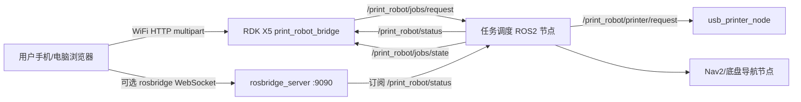

# RDK X5 与 ROS2 集成

> 公开归档说明：本文是部署与待集成步骤，不是整机验收记录。仓库包含 Web/PWA、演示 HTTP 服务、ROS2 HTTP 桥接和 USB 打印节点；调度器、Nav2/底盘驱动、真实地图与设备均需另行提供。桥接 API 可达只表示服务连接，CUPS 命令成功只表示打印请求已提交，均不证明导航就绪或纸张已输出。所有工位/地图坐标与用户数据为示例，不能直接用于实机。当前验证见 [验证记录](../docs/VALIDATION.md)。

## 推荐架构



文件上传不建议直接塞进 ROS2 topic。网页先把文件通过 HTTP 上传到 RDK X5，桥接节点保存文件并把文件路径、打印参数、目标工位发布到 ROS2。打印机已经安装在小车上，作为 USB 车载外设使用。`usb_printer_node` 会调用 RDK X5 上的 CUPS/`lp` 命令打印文件。

## 在 RDK X5 上运行桥接节点

进入本项目的 ROS2 工作区：

```bash
cd ros2_ws
colcon build --symlink-install
source install/setup.bash
ros2 launch print_robot_bridge bridge.launch.py
```

默认 HTTP API：

```text
http://0.0.0.0:8080
```

可通过参数修改：

```bash
ros2 launch print_robot_bridge bridge.launch.py host:=0.0.0.0 port:=8080 upload_dir:=/tmp/print_robot_uploads
```

如果要同时启动网页桥接和 USB 打印节点：

```bash
ros2 launch print_robot_bridge robot_print_system.launch.py \
  host:=0.0.0.0 \
  port:=8080 \
  printer_name:=你的打印机名称
```

## 可选：启用 rosbridge

如果希望网页直接订阅 ROS2 状态 topic，可以在 RDK X5 上启动 rosbridge：

```bash
ros2 launch rosbridge_server rosbridge_websocket_launch.xml
```

网页连接设置中填写：

```text
ws://<RDK_X5_IP>:9090
```

状态 topic：

```text
/print_robot/status
```

## 调度节点需要实现的最小闭环

1. 订阅 `/print_robot/jobs/request`。
2. 读取任务中的 `targetPose` 和 `printSettings.printMode`。
3. 如果 `printMode` 是 `mobile_print`，下发打印指令，同时控制底盘导航至目标工位。
4. 如果 `printMode` 是 `manual_at_station`，先控制底盘导航至目标工位，再发布待人工打印状态。
5. 发布 `/print_robot/status` 和 `/print_robot/jobs/state`。
6. 订阅 `/print_robot/jobs/cancel`，对排队或未完成任务执行取消。

## USB 打印节点

启动 USB 打印节点：

```bash
ros2 launch print_robot_bridge usb_printer.launch.py printer_name:=你的打印机名称
```

默认参数：

```text
backend=cups
print_command=lp
auto_print_modes=mobile_print
manual_print_topic=/print_robot/printer/request
```

含义：

```text
mobile_print       收到网页任务后自动打印
manual_at_station  不自动打印，等待调度节点到达工位后发布 /print_robot/printer/request
```

到达工位后触发打印：

```bash
ros2 topic pub /print_robot/printer/request std_msgs/msg/String "{data: '{\"id\":\"JOB-123456\",\"filePath\":\"/tmp/print_robot_uploads/JOB-123456/demo.pdf\",\"force\":true,\"printSettings\":{\"copies\":1,\"pages\":\"全部\",\"colorMode\":\"mono\",\"duplex\":\"single\",\"paperSize\":\"A4\"}}'}"
```

打印节点会发布：

```text
/print_robot/printer/state
/print_robot/jobs/state
```

## 快速测试 topic

发布机器人状态：

```bash
ros2 topic pub /print_robot/status std_msgs/msg/String "{data: '{\"robot\":{\"state\":\"printing_en_route\",\"floor\":\"3F 办公区\",\"location\":\"前往产品 C-05\",\"x\":466,\"y\":330,\"battery\":82,\"speed\":0.22},\"printer\":{\"state\":\"printing\",\"activeJobId\":\"JOB-123456\",\"queueLength\":2,\"waitSeconds\":120,\"progress\":64},\"network\":{\"ip\":\"192.168.1.20\",\"rssi\":-52}}'}"
```

监听网页提交的任务：

```bash
ros2 topic echo /print_robot/jobs/request
```

监听取消指令：

```bash
ros2 topic echo /print_robot/jobs/cancel
```

## 工位坐标配置

现在项目已经内置了工位配置文件：

```text
web/config/office_3f.json
ros2_ws/src/print_robot_bridge/config/office_3f.json
```

前端读取 `web/config/office_3f.json`，RDK X5 上的 ROS2 桥接节点读取 `ros2_ws/src/print_robot_bridge/config/office_3f.json`。两份文件结构相同，真实部署时保持内容一致。

前端地图使用 900 x 520 的 UI 坐标系。真实机器人导航使用 ROS2 `map` 坐标：

```json
{
  "id": "C-05",
  "label": "产品 C-05",
  "type": "desk",
  "selectable": true,
  "ui": {
    "x": 466,
    "y": 330
  },
  "ros": {
    "x": 4.1,
    "y": 0.1,
    "yaw": 1.57
  }
}
```

字段含义：

```text
id          提交任务时传给 RDK X5 的工位编号
label       网页显示名称
type        desk | dock
selectable  是否允许用户选择为配送目标
ui          网页地图上的显示坐标
ros         Nav2 使用的真实 map 坐标和到达朝向
```

前端只负责显示和提交工位编号，真实路径规划由 ROS2/Nav2 完成。

## 替换为真实地图图片

保存地图后会得到：

```text
office_3f.yaml
office_3f.pgm
```

把 `pgm` 转成 PNG 后放到：

```text
web/maps/office_3f.png
```

然后修改：

```text
web/config/office_3f.json
```

把 `uiMap.image` 改成：

```json
"./maps/office_3f.png"
```

如果图片放置范围需要微调，改 `uiMap.imageBounds`：

```json
{
  "x": 24,
  "y": 34,
  "width": 852,
  "height": 452
}
```

## 在 RDK X5 上指定配置文件

默认情况下，桥接节点会读取安装包内的 `config/office_3f.json`。也可以启动时显式指定：

```bash
ros2 launch print_robot_bridge bridge.launch.py \
  host:=0.0.0.0 \
  port:=8080 \
  stations_config:=/opt/office-print-robot-console/config/office_3f.json
```

网页提交任务后，`/print_robot/jobs/request` 会带上真实导航目标：

```json
{
  "id": "JOB-123456",
  "targetStation": "C-05",
  "targetLabel": "产品 C-05",
  "printSettings": {
    "printMode": "mobile_print"
  },
  "targetPose": {
    "x": 4.1,
    "y": 0.1,
    "yaw": 1.57
  }
}
```
